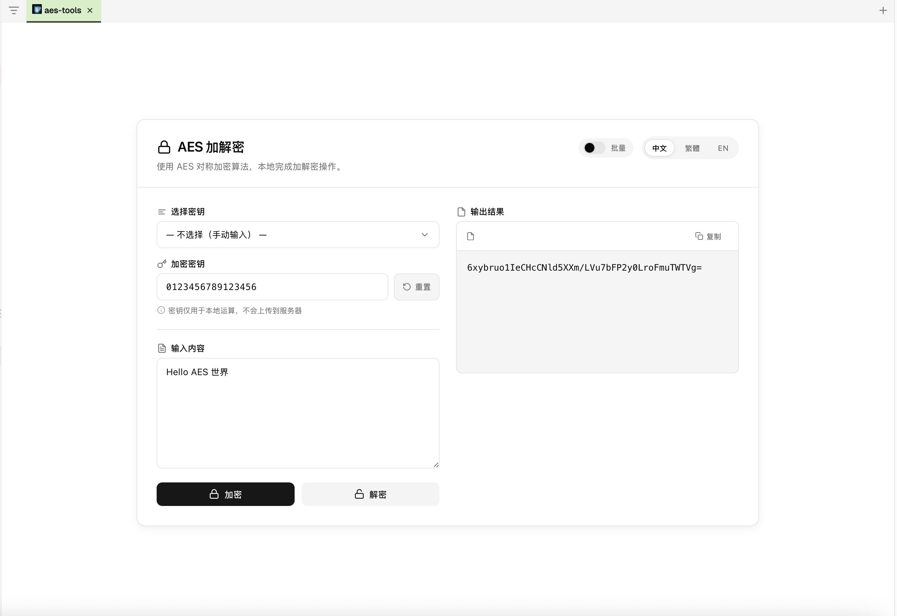

# aes-tools

A [DBX](https://dbxio.com) plugin providing AES-128-ECB encryption and decryption tools, compatible with [Hutool](https://hutool.cn/)'s default AES configuration.

Built with a **Rust** sidecar backend and a shadcn/ui-style frontend workbench.



[中文文档](README.zh-CN.md)

## Features

- **AES-128-ECB** encryption / decryption with **PKCS7** padding
- **Base64** output encoding, compatible with Hutool defaults
- Multiple AES key management via labels
- Connection-based key storage (key per DBX connection)
- Dark mode support, following shadcn/ui design system
- Multi-language UI: zh-CN, zh-TW, en, ja, ko

## Prerequisites

- [Node.js](https://nodejs.org/) 22+
- [Rust](https://www.rust-lang.org/) toolchain
- [DBX Plugin CLI](https://www.npmjs.com/package/@dbx-app/plugin-cli)

## Quick Start

```bash
git clone <repo-url> && cd aes-rust-plugin
dbx-plugin dev --path . --port 5190
```

The CLI builds the Rust backend and serves the UI. Dev credentials are stored in `.dbx-dev/` (git-ignored).

## Usage

### Connection Setup

| Field | Description | Default |
|-------|-------------|---------|
| Host | Target server host | `localhost` |
| Port | Target server port | `8080` |
| aes key | Default AES key (16 bytes) | `1234567890123456` |
| aes key label | Key label list (JSON) | see below |

**Key label format**:
```json
[{"label":"默认密钥","value":"default_key","aes_key":"1234567890123456"}]
```

### API Methods

| Method | Description |
|--------|-------------|
| `aes-rust-plugin/ping` | Health check |
| `aes-rust-plugin/aesEncrypt` | AES encrypt plaintext |
| `aes-rust-plugin/aesDecrypt` | AES decrypt ciphertext |
| `aes-rust-plugin/aesKey` | Get current connection's AES key |
| `aes-rust-plugin/aesKeyLables` | Get key labels config |

## Build & Package

```bash
bash scripts/build.sh       # Build and package .dbxp for current platform
dbx-plugin package .        # Or use CLI directly
```

Output goes to `dist/`.

## Project Structure

```
├── manifest.json          # Plugin manifest (v1)
├── dbx-plugin.toml        # Build config
├── backend/               # Rust sidecar backend
│   ├── Cargo.toml
│   └── src/
│       ├── main.rs        # Plugin handler & IPC server
│       └── aes_util.rs    # AES-128-ECB encrypt/decrypt impl
├── ui/
│   └── index.html         # shadcn/ui-style workbench
├── assets/
│   └── plugin.svg         # Plugin icon
├── scripts/               # Build & dev scripts
└── shared/sdk/            # Vendored DBX Plugin SDK
```

## Tech Stack

- **Backend**: Rust + `dbx-plugin-sdk` (sidecar IPC)
- **Crypto**: `aes` + `ecb` + `base64` crates
- **Frontend**: Vanilla HTML/CSS/JS, shadcn/ui design tokens

## Release

1. Publish a GitHub Release — CI builds unsigned `.dbxp` for all targets.
2. Submit a candidate PR to [`t8y2/dbx-store`](https://github.com/t8y2/dbx-store).
3. After review, DBX Store signs and publishes.

## License

MIT